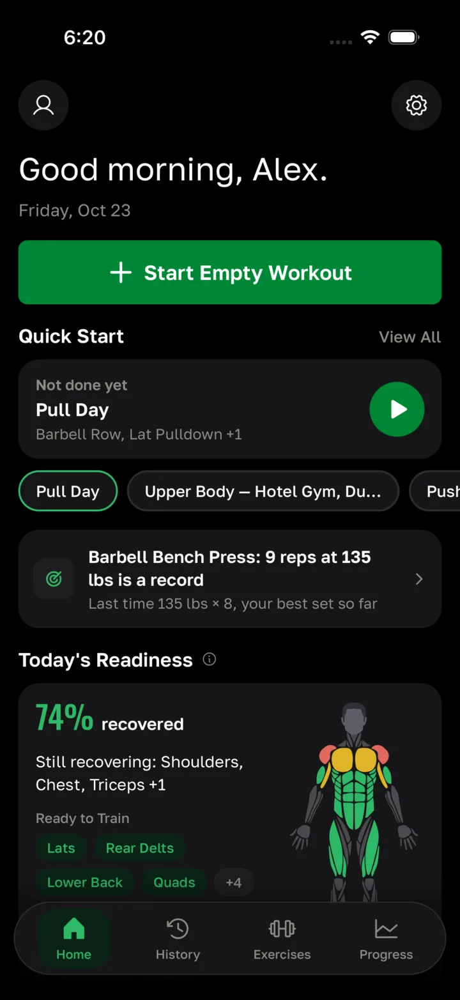
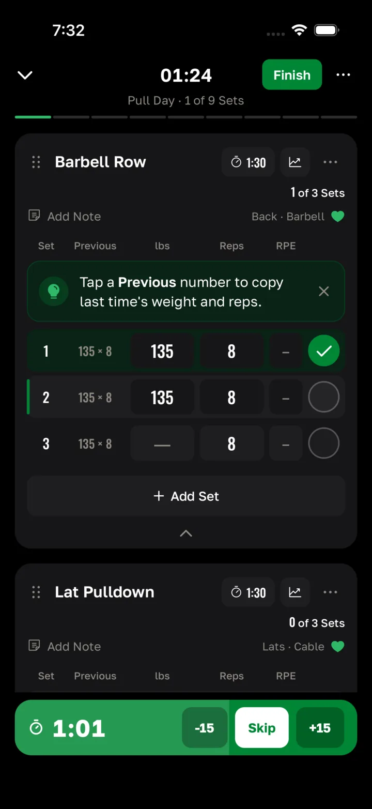
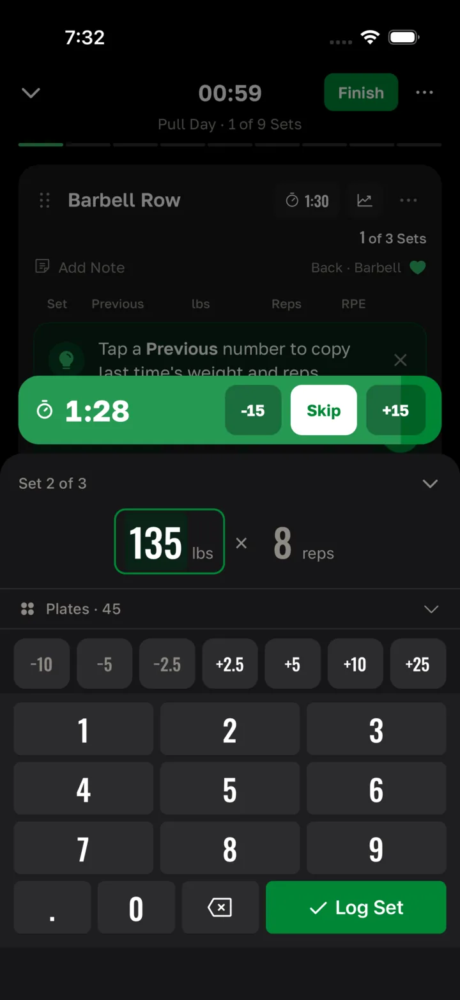
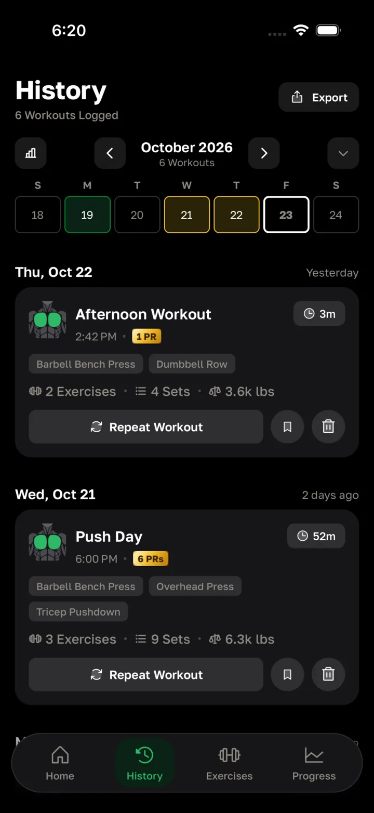
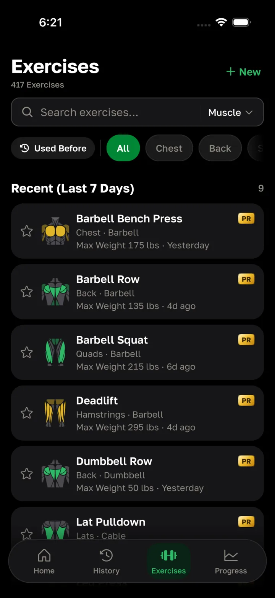
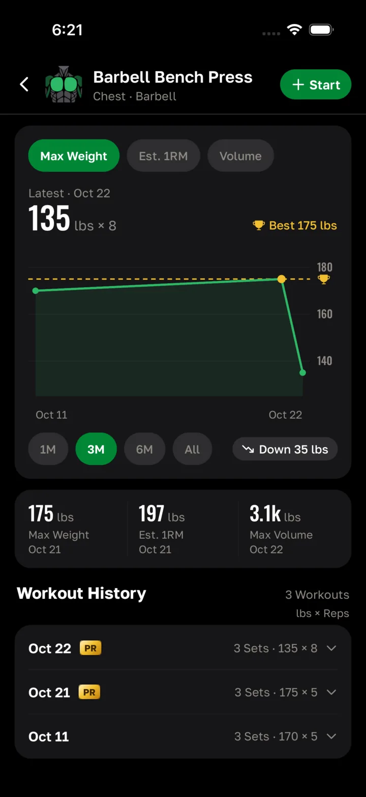
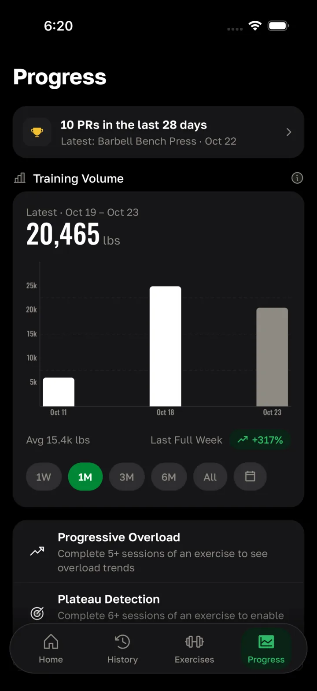
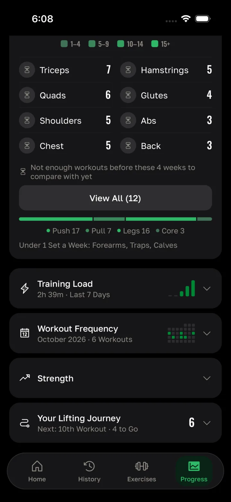
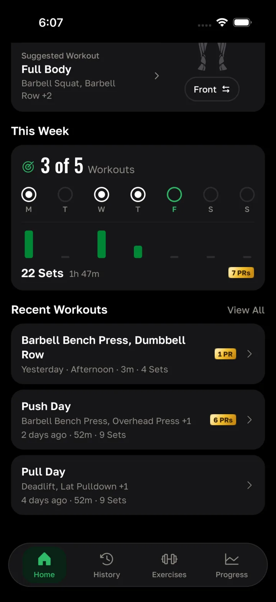
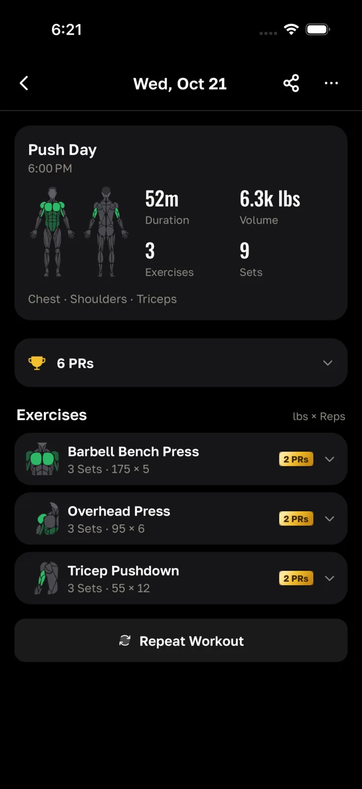

  

# Everlift

A gym workout tracker for iPhone, iPad and Android. Started in January 2026, currently on 1.0.14 — the redesign.

The source is private — this is the write-up.

---

## The one constraint

**Logging a set has to be faster than the rest between sets.**

That's the whole design brief. If you're standing at a rack with 90 seconds of rest and the app needs six taps, you stop using it by week three — I stopped using two other trackers for exactly that reason.

Almost every structural decision falls out of it. There's no signup, so first launch drops you into a workout. The next set comes pre-filled from the last one. Rest starts on its own when you complete a set, and you can adjust or skip it from the lock screen without reopening the app. Analytics live two screens deep, because you don't read charts mid-set.

## What I got wrong about the math

The app claims "honest training math." That claim exists because I audited my own and found it wasn't.

It took six passes through the codebase:

| Pass | What was wrong |
| --- | --- |
| 1 | Goal progress percentages, and weight units surviving export/import |
| 2 | Bodyweight load, and completed-set counts |
| 3 | Calendar day labels, and a streak that broke across the UTC boundary |
| 4 | Measurement unit provenance — no way to tell what unit an old row was saved in |
| 5 | Six separate chart and stat calculations |
| 6 | Readiness copy that described a calculation the app wasn't doing |

The one that bothered me most: **drop-set clusters were counted as multiple sets everywhere.** Your volume looked better than it was. If you're going to put a number in front of someone who's trying to get stronger, it has to be the real number — so that got fixed everywhere at once rather than per-screen.

Related, and subtle: the "Previous" value shown next to each set was matching by raw index. Do a warm-up set one day and skip it the next, and it showed you the wrong set to beat. It now matches by set-type role.

## Other things that broke

- **The barbell graphic ran off both screen edges** once the weight got high enough. Plate counts moved off the graphic into a breakdown line.
- **Per-exercise rest times never saved.** The seed data was corrupting the NULL sentinel the setting depended on.
- **Backgrounding the app could eat your last set** — the draft was debounced and never flushed on background.
- **Limb measurements silently didn't sync**, from one mismatched key in `LOCAL_TO_REMOTE_MAP`.
- **Changing language didn't survive a restart.** The reload raced the cloud push.
- **Apple rejected a release over a `✓` character** in the store copy — it's on App Store Connect's banned list. Nine locales to correct.

## Reach

Nine languages: English, Spanish, Portuguese (BR), German, French, Japanese, Korean, Russian, Simplified Chinese. Localization was the single most tedious part of shipping, and I'd budget triple the time for it next round — the copy is the easy half, and store metadata in nine locales is the other.

414 exercises with search aliases, custom exercises and muscle mapping.

The plate calculator holds your gym's actual plate inventory, because a calculator that assumes plates you don't own tells you to load a bar you can't.

## Product tour

  
  
  
  
  
  
  
  
  
  

## Engineering

`React Native` · `Expo` · `TypeScript` · `Tamagui` · `SQLite` · `Drizzle ORM` · `Supabase` · `Zustand` · `SwiftUI`

Writes land in local SQLite first and sync afterwards, so the app is fully usable with no account and no signal. That choice bought reliability and cost me most of a release in sync bugs — durable deletes, tombstone purging, orphan cleanup, and a mutex to stop concurrent pushes from racing. Offline-first is the right default; it is not the cheap one.

The lock-screen rest timer and Dynamic Island support are native (SwiftUI), since that's the only way to control a timer without reopening the app.

Two fixes worth naming because they're the boring kind that matter: `SECURITY DEFINER` functions were reachable on the public REST surface, and a premium-override email was being logged in production builds.

---

> Public showcase. Everlift's production source and operational configuration stay private.
